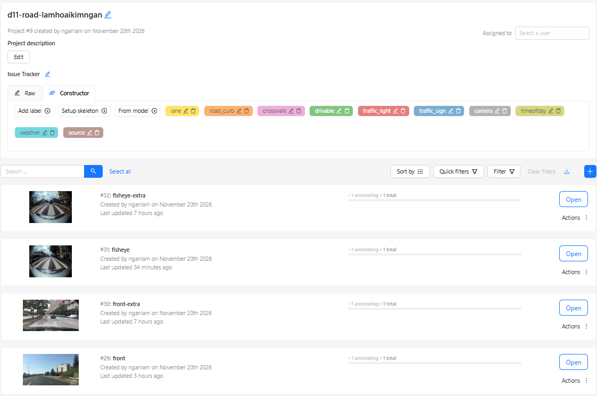
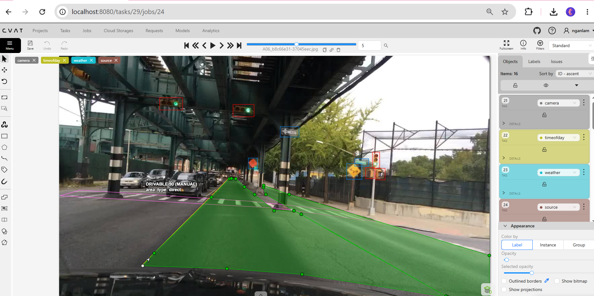
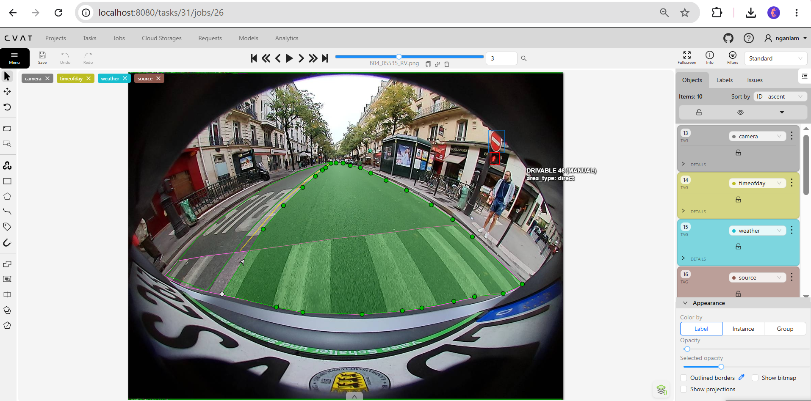
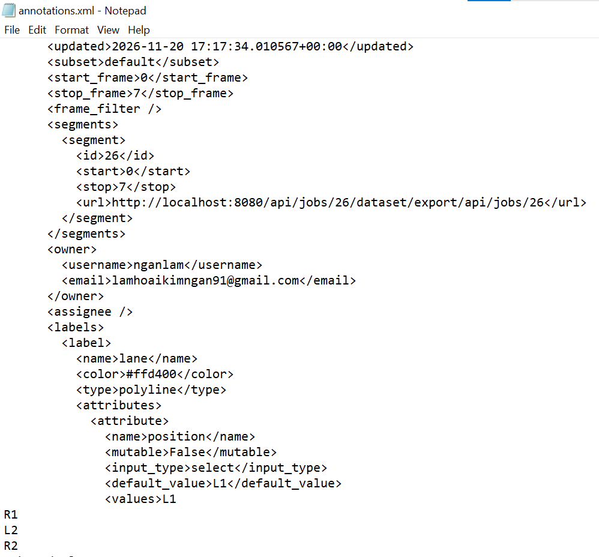

# Báo cáo cá nhân — Ngày 11
Họ tên: Lâm Hoài Kim Ngân               Mã học viên: 2A202603305  
Phiên bản CVAT (Help → About): v2.82.0  
Guideline: Road v1.0    Lần nộp (`revision` trong manifest): 2  
Thời điểm export (ngày giờ trên CVAT): 2026-11-20T17:41:46+00:00    Số lần nộp lại sau Rework: 1  

## 1. Kiểm project
| Mục | Đúng như guideline Road v1.0? | Ghi chú |
| --- | --- | --- |
| 6 label, đúng kiểu | Đúng | Đủ 6 label: `lane` (polyline), `road_curb` (polyline), `crosswalk` (polygon), `drivable` (polygon), `traffic_light` (rectangle), `traffic_sign` (rectangle). |
| Thuộc tính và giá trị | Đúng | Khớp hoàn toàn với taxonomy Road v1.0 (chuẩn hóa theo `configs/road_v1_labels.json`). |
| 4 tag ảnh | Đúng | Đủ 4 tag ảnh: `camera`, `timeofday`, `weather`, `source`, mỗi tag có thuộc tính select `value`. |

Cách kết thúc polyline trên bản CVAT này: Nhấn phím `N` trên bàn phím sau khi hoàn thành việc click các điểm trên tâm vệt sơn (hoặc click vào điểm cuối cùng).  
Cách đặt tag ảnh trên bản CVAT này: Dùng công cụ Tag ở thanh công cụ bên trái (phím tắt `L` hoặc chọn biểu tượng Tag), đặt tag `camera` trước tiên, sau đó đặt `timeofday`, `weather`, `source`; mở phần Details trong bảng Objects để kiểm tra và gán đúng giá trị `value`.  

## 2. Số lượng đã gán
| Task | Ảnh | lane | road_curb | crosswalk | drivable | traffic_light | traffic_sign |
| --- | ---: | ---: | ---: | ---: | ---: | ---: | ---: |
| front | 12 | 28 | 0 | 3 | 22 | 17 | 21 |
| front-extra (đã làm 0 / 4) | 0 | 0 | 0 | 0 | 0 | 0 | 0 |
| fisheye | 8 | 7 | 0 | 7 | 11 | 3 | 4 |
| fisheye-extra (đã làm 0 / 4) | 0 | 0 | 0 | 0 | 0 | 0 | 0 |

## 3. Bảng ca khó
| Ảnh | Nhãn | Phân vân giữa | Đã chọn | Lý do |
| --- | --- | --- | --- | --- |
| A03_b1c66a42-6f7d68ca.jpg | lane / road_curb | Phân vân có vẽ thêm vạch sơn L1 hay chỉ vẽ road_curb | Không vẽ L1, vẽ road_curb | Mép đường bên trái là vỉa hè không có vạch sơn kẻ đường; theo quy tắc mục 6 không vẽ vạch mà ảnh không có (đã được coach xác nhận miễn lỗi QC1-02). |
| A04_b7a8e795-0ff55db2.jpg | lane | Phân vân vẽ 2 polyline riêng rẽ hay 1 polyline kind=double cho tim đường vàng đôi | 1 polyline, kind=double, color=yellow, position=L1 | Guideline Road v1.0 quy ước vạch đôi vẽ 1 polyline chạy giữa tim đường và gán thuộc tính kind=double. |
| B03_04267_RV.png | traffic_sign | Phân vân bật hay tắt thuộc tính edge_zone | edge_zone = true | Biển báo có tâm hộp nằm ở bán kính $r \approx 513\text{ px}$, vượt quá 80% bán kính ảnh fisheye ($0.8 \times 640 = 512\text{ px}$). |

## 4. Phiếu QC 1 nhận được
Bạn kiểm lô của tôi: tuan    Quyết định nhận được: Rework (bản revision 1)  
| Mã lỗi | Số lỗi | Đồng ý? | Đã sửa? |
| --- | ---: | --- | --- |
| QC1-04 (vẽ ngược từ xa về gần) | 7 | Đồng ý | Đã sửa: đảo ngược thứ tự điểm của polyline trên các ảnh A02, A03, A07, A11, A12 để vẽ đúng từ gần xe ra xa. |
| QC1-05 (trùng position L1/L2) | 5 | Đồng ý | Đã sửa: xóa nét vẽ đúp trên vạch đôi A01, đổi position vạch bên phải thành R2 trên A04, chuẩn hóa L1/L2 trên A09, A10, A11. |
| QC1-11 (quên bật edge_zone) | 3 | Đồng ý | Đã sửa: bật `edge_zone = true` cho các box đèn và biển nằm ngoài 80% bán kính trên B02, B04. |

## 5. Kiểm file export
| File | Mở lại được? | Số shape ảnh 1 (job / file) | Số shape ảnh 2 (job / file) | Tag camera có trong XML? |
| --- | --- | --- | --- | --- |
| lamhoaikimngan-front.zip | Có (PASS road_check lint) | 8 / 8 | 5 / 5 | Có (`<tag label="camera"><attribute name="value">front</attribute></tag>`) |
| lamhoaikimngan-fisheye.zip | Có (PASS road_check lint) | 2 / 2 | 3 / 3 | Có (`<tag label="camera"><attribute name="value">fisheye_front</attribute></tag>`) |

## 6. Ảnh chụp màn hình
1. **Tab Labels của project trên CVAT:**  
  
*(Minh chứng cấu hình đầy đủ 6 shape labels và 4 tag labels đúng chuẩn taxonomy Road v1.0)*

2. **Một ảnh camera trước đã gán đủ (làn, vùng lái, đèn/biển):**  
  
*(Ảnh front đã gán hoàn chỉnh đầy đủ lane L1/R1/L2/R2, drivable direct/alternative, traffic_sign và traffic_light)*

3. **Một ảnh fisheye đã gán, phóng to đoạn polyline cong:**  
  
*(Ảnh fisheye phóng to đường cung cong của polyline bám sát mép cong quang học, đặt điểm dày ở vòng ngoài)*

4. **Một đoạn code XML mở từ file zip có thẻ `<polyline label="lane">`:**  
  

*Trích xuất nội dung thẻ XML tương ứng từ file `annotations.xml`:*
```xml
<polyline label="lane" occluded="0" source="manual" points="711.23,718.08;602.40,642.10;536.80,594.30;483.50,556.20;445.10,528.90;418.40,511.66" z_order="0">
  <attribute name="position">R1</attribute>
  <attribute name="style">dashed</attribute>
  <attribute name="color">white</attribute>
  <attribute name="kind">single</attribute>
</polyline>
```

## 7. Tự đánh giá
- **Lỗi bạn mắc nhiều nhất hôm nay (theo mã QC1-xx), và cách tránh ở Ngày 20:**  
Lỗi mắc nhiều nhất trong đợt gán đầu tiên là **QC1-04** (vẽ polyline ngược chiều từ xa lại gần trên một số ảnh dốc và ngã tư) cùng với **QC1-11** (quên bật `edge_zone` ở ảnh fisheye).  
*Cách tránh ở Ngày 20:* Luôn ghi nhớ nguyên tắc vàng: click điểm đầu tiên sát capô xe (đáy ảnh, y lớn nhất), sau đó mới click tịnh tiến dần ra xa. Đối với camera fisheye, ngay sau khi vẽ box đèn/biển, kiểm tra tâm đối tượng có nằm ngoài vùng 80% bán kính ảnh hay không để tick chọn `edge_zone`.

- **Nhãn của bạn đi vào model ở đâu? Chọn một lỗi đã sửa và nói nó làm model học sai thế nào:**  
Dữ liệu nhãn polyline lane được đưa vào huấn luyện các mô hình phát hiện làn xe theo phương pháp neo hàng (Row-Anchor Based Lane Detection như Ultra-Fast-Lane-Detection hoặc CLRNet). Các mô hình này học cách dự đoán tọa độ x của vạch làn tại các hàng quét $y \in [720, 680, 640, \dots]$.  
*Nếu mắc lỗi QC1-04 (vẽ ngược hoặc dừng polyline sớm):*  
1. Thuật toán nội suy điểm neo dựa theo thứ tự index điểm sẽ bị đảo lộn, khiến gradient hồi quy tọa độ bị sai hướng hoàn toàn giữa điểm gần xe và xa xe.  
2. Tại các hàng quét sát đầu xe ($y=720$), nhãn bị chuyển thành "không có làn" (background). Hậu quả trực tiếp là thuật toán điều khiển giữ làn (LKA - Lane Keeping Assist) trên xe tự hành bị mất tín hiệu làn ngay trước bánh xe, tính sai góc lệch tức thời, dẫn đến xe giật vô lăng đột ngột hoặc trôi lệch khỏi làn đường gây nguy hiểm nghiêm trọng.

## 8. (Tùy chọn, buffer) Từ polyline đến đích row-anchor
| y | 720 | 680 | 640 | 600 | 560 |
| --- | ---: | ---: | ---: | ---: | ---: |
| x của chúng tôi (lamhoaikimngan) | không có làn | 657.6 | 601.3 | 544.3 | 487.4 |
| x của bạn kia (tuan) | 712.6 | 656.0 | 599.4 | 542.2 | 484.5 |

Trả lời 3 câu:

1. **Năm số x đó chính là đích mà một model row-anchor học cho vạch này. Nếu bạn dừng polyline sớm 40 px, hàng nào đổi thành "không có làn"?**  
   - Hàng neo $y=720$ sẽ bị đổi thành "không có làn" (vì điểm bắt đầu vẽ bị dừng ở $y \le 680$, nằm ngoài phạm vi bao phủ của polyline).
2. **So với bạn được kiểm (cùng ảnh): ở hàng 720 và hàng 560, hai bạn lệch nhau bao nhiêu pixel? Lệch ở hàng nào ảnh hưởng LKA nhiều hơn (slide 25)?**  
   - Ở hàng 720: Bạn kia đạt $x = 712.6\text{ px}$, trong khi của chúng tôi là "không có làn" (mất điểm sát xe).  
   - Ở hàng 560: Chúng tôi là $487.4\text{ px}$, bạn kia là $484.5\text{ px}$, độ lệch là $|487.4 - 484.5| = 2.9\text{ px}$.  
   - **Lệch ở hàng 720 (sát đầu xe) ảnh hưởng nghiêm trọng đến LKA hơn rất nhiều**: Theo slide 25 của bài giảng, bộ điều khiển LKA sử dụng độ lệch ngang cục bộ ngay trước đầu xe để tính toán góc bẻ lái phản hồi tức thời. Lệch ở cự ly gần làm sai lệch góc bẻ lái ngay trong vòng lặp điều khiển tiếp theo, gây mất an toàn trực tiếp; trong khi lệch ở cự ly xa (hàng 560) chỉ ảnh hưởng tới thành phần dự đoán tương lai (feed-forward curvature).
3. **Nếu polyline vẽ từ xa về gần (ngược quy tắc 2), cách tính trên có đổi không? Script nào sẽ gặp khó?**  
   - Về mặt hình học tĩnh của tập hợp đoạn thẳng, đường cong không đổi hình dạng. Tuy nhiên, trong pipeline xử lý dữ liệu huấn luyện, script trích xuất điểm theo thứ tự (point ordering) hoặc thuật toán nội suy tuần tự từ đáy ảnh lên sẽ gặp lỗi: script duyệt từ điểm xa nhất thay vì điểm gần nhất, dẫn đến thứ tự index bị đảo ngược, làm vector đặc trưng của vạch bị đảo chiều 180 độ hoặc gán sai nhãn điểm bắt đầu/kết thúc làn.
